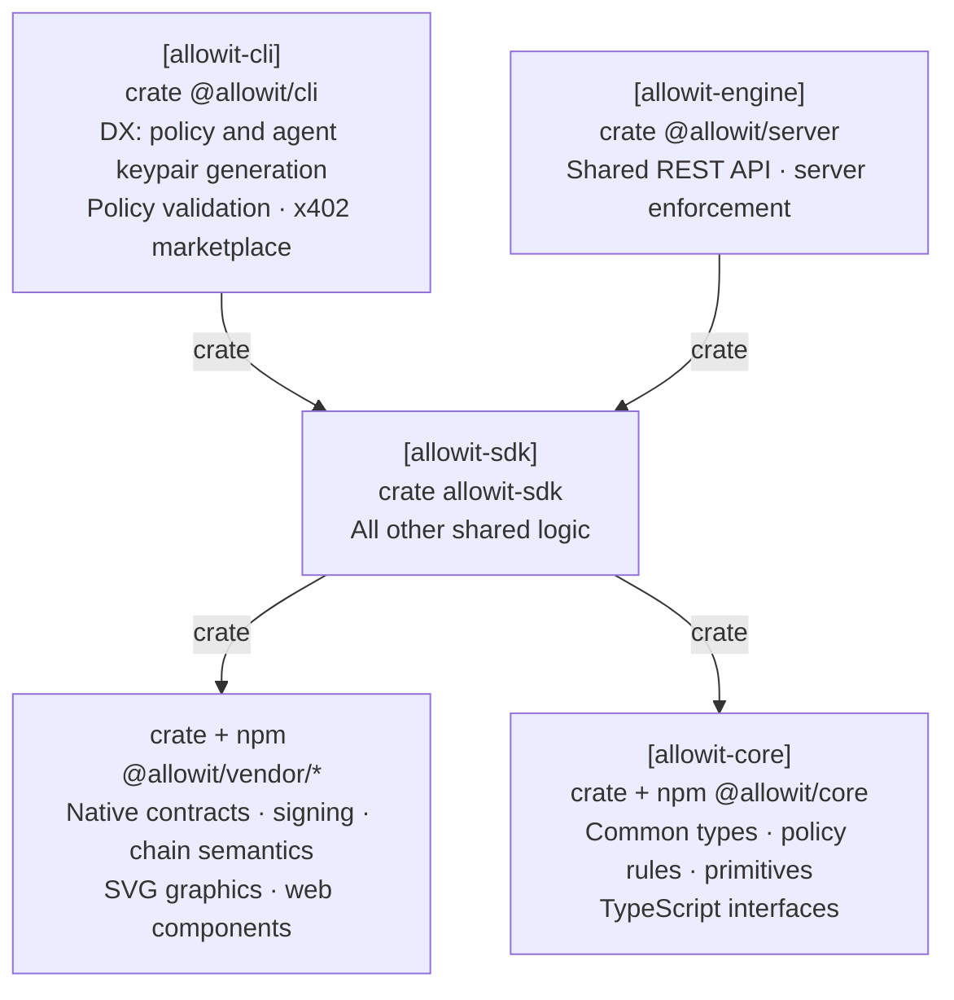

# Allowit SDK

**Go on. On your terms.**

This repository contains `allowit-sdk`, the shared offchain execution library.
Both CLI and server callers use SDK engine. Each actor retains its own keys, authorization and durable application state.
The [Allowit CLI](https://github.com/allowit-hq/allowit-cli) owns terminal commands and local configuration.
Server enforcement, native authority and verified settlement remain authoritative.

[Allowit core](https://github.com/allowit-hq/allowit-core) contains the portable `allowit` policy library, its shared source gate and feature-gated host primitives.
Rail libraries own native requests, encoding, signatures, RPC methods, simulation and settlement rules.
The [workspace manifest](Cargo.toml), [lockfile](Cargo.lock) and [plugin registration](crates/allowit-sdk/src/plugins/registered.rs) define this build.
SDK engine composes those capabilities into preparation, execution, status and recovery workflows.
The server adds trusted policy context, admission, server authority, reservations and accounting.

## Architecture

SDK engine owns reusable execution logic for CLI and server callers.



## Wallet kinds, units and the owner workflow

Hosts offer the same four wallet kinds and show the same text. Core describes them; each rail advertises the kinds
it supports. The selection id `standard` names the tier that technical names call Common, and its supported params
are listed in the [Core README](https://github.com/allowit-hq/allowit-core/blob/main/README.md#standard-wallet-parameters).

| Need | Rust (`allowit_sdk`) | npm (`@allowit/sdk`) |
| --- | --- | --- |
| All kinds | `kinds::WALLET_KINDS`, `kinds::WalletKind` | `walletKinds()`, `walletKind(id)` |
| Kinds of a rail | `kinds::wallet_kinds(network)` | `walletKindsFor(network)` |
| Kind that a wallet binds | `kinds::wallet_kind(network, profile)`, `Profile::wallet_kind()`, `ConfigurationInfo::wallet_kind()` | `walletKindOf(network, document)` |
| Unit of an asset | `kinds::native_asset(network)`, `kinds::asset_display(network, asset)` | `nativeAsset(network)`, `assetDisplay(network, asset)` |
| Print an amount | `kinds::format_amount(network, asset, units)`, `AssetDisplay::format(units)` | `formatAmount(network, asset, units)`, `formatUnits(units, decimals)` |
| Settled operation | `execution::Settlement::of(&outcome.document)` | `settlementOf(document)` |
| Fee that the limits count | `execution::fee_charged(&outcome.document)` | `feeChargedOf(document)` |
| Spent and remaining per limit | `execution::Limits::of(&outcome.document)`, `execution::limits(profile, signer, root, rpc)` | `limitsOf(document)` |
| Limit of each payment | `execution::payment_limits(&profile)`, `execution::payment_limits_of(network, document)`, `execution::WalletLimits::payment_of(&document)` | `paymentLimitsOf(document)` |
| All limits of a wallet | `execution::wallet_limits(profile, signer, root, rpc)` returns `WalletLimits { limits, payment_limits }` | `limitsOf(document)` with `paymentLimitsOf(document)` |
| Explorer link of an operation | `execution::explorer(&outcome.document)` | the `explorer` text of the document |
| Choose a wallet kind | `generation::GenerateRequest.wallet_kind`, `GeneratedDraft::wallet_kind()`, `generation::wallet_kind_of(document)` | `walletKindIdOf(document)`, the `walletKind` field of a generate or adopt request |
| Refused wallet kind | `error.api_code`, `error.details`, `error.detail("reason")` | `walletKindRefusal(error)` |
| Print the params of a draft or profile | `kinds::param_lines(network, document)`, `kinds::profile_param_lines(&profile)` | `reviewParamLines(network, params)` |
| Review and sign | | `parseReviewLink`, `reviewAgentPrompt`, `reviewParamLines`, `installAndFund(network, input)` |
| Kind that a Review and sign link names | | the `walletKind` field of `parseReviewLink(fragment)`, beside `proposal` |
| Typed values of the owner's text | `owner::typed_changes(network, document, edits, now)`, `parameters::set_all` | the typed editors of the host |
| Change the params of a draft | `owner::edit_params(cx, EditParams)`, `owner::revise(cx, Revise)` | the `micro/params` and `micro/revise` owner routes |
| Change the params of an active wallet | `owner::update_params(cx, UpdateParams)`; server: `Runtime::prepare_params_update`, `Configuration::with_params` | `updateParams(network, input)` |
| Verify an installation on the ledger | `owner::verify(cx, document)` returns `Verification { matches, comparisons, state }` | |
| Host and native placements | `owner::paired_export(network, document)` returns `PairedExport { host, native }` | |

An owner changes installed params on an active wallet with one signature. The server prepares the owner step
with `Runtime::prepare_params_update` and stores `Configuration::with_params` after the step settles; the wallet
keeps its recorded usage and its request nonce. `owner::update_params` and `updateParams` are resume-safe under
their request ID or journal key. `owner::verify` compares the owner's document with the ledger and reads the
state back; `Verification::matches` is true only when every comparison matches. A rail without a call declares
`Feature::EditParams`, `UpdateParams`, `Verify` or `PairedExport` skipped, and npm rejects `updateParams` with
the code `update_unavailable`.

A host never prints a unit of its own. An asset without a known unit is an error in Rust and `null` in npm.
`npm/src/wallet-kinds.js` is generated from Core by the test `npm_wallet_kinds_equal_the_core_description`;
run it with `ALLOWIT_WRITE_WALLET_KINDS=1` after a Core change.
`progress::set_sink` installs the sink for the progress lines of long provider steps.

## Write a portable policy

Policies are synchronous Rust against the `allowit` package:

```rust
use allowit::prelude::*;

pub fn execute(ctx: &AllowitContext) -> allowit::Result {
    allowit::operations(ctx, &ctx.params[allowit::OPERATIONS])?;
    allowit::daily_spending_limit(ctx, &ctx.params[allowit::DAILY_SPENDING_LIMIT])?;
    allowit::payment_limit(ctx, &ctx.params[allowit::PAYMENT_LIMIT])?;
    Ok(())
}
```

The host and the rail's policy contract use the same source. Owner-approved params supply the exact limits in base units.
Request amounts, native identity, accounting and enrichment come from the executing host and rail.
Policy source cannot provide its own trusted spending state.

The shared host build gate runs Core's Rust source gate, then compiles the source with `rustc` against the exact portable library before installation authorization.
See the [portable policy reference](docs/policy-reference.md) for source restrictions and wallet tiers.

## Embed SDK engine

[`crates/allowit-sdk/`](crates/allowit-sdk/) contains shared workflows without terminal I/O:

- `runtime::Runtime` composes native preparation, required durable retention, submission and recovery.
- `plugins` holds the rail plugin registry. `plugins::for_network(network)` returns the registered `RailPlugin` (trait in `allowit_core::vendor::plugin`) for a CAIP-2 id or alias. Engine, CLI and app code reach vendor behavior only through it.
- `generation`, `owner` and `execution` dispatch owner sign-in, policy generation, owner workflows, execution, status and recovery to the selected plugin. Callers pass their signer capability and a private core `Store`.
- `typed_request` bounds document ingress and derives the versioned operation identity.
- `wallet`, `routing` and `config` supply explicit caller bindings and registered network selection.
- `paid_service` and `marketplace` serve paid calls. See [Paid calls and the marketplace](#paid-calls-and-the-marketplace).

## Paid calls and the marketplace

A paid call buys one resource from a seller that answers with a payment challenge (HTTP 402).

1. `paid_service::send` requests the resource. The body is bounded at 8 MiB, redirects are not followed and the
   request is sent once.
2. `paid_service::challenge(network, resource, reply)` asks the rail of the selected network to parse the
   challenge. The rail validates the network, the asset, the recipient and the amount. The result is a
   rail-neutral `Challenge` with the amount as a `Quantity`.
3. The caller pays with `execution::execute`: an ordinary transfer to `challenge.pay_to` with
   `Request::paid_service` set to `challenge.context()`. The server evaluates the policy on the transfer as for
   any other payment and records the context in the receipt (`paidService`).
4. `paid_service::proof(challenge, receipt)` builds the request header from the outcome document of the
   confirmed operation. `paid_service::send` presents it with the second request.

Nothing waits for or calls a third party to settle: Allowit settles the payment, and the seller verifies the
proof on its own. A seller that gives no answer, or a reply that is no usable challenge, is the error code
`SELLER_FAILED` (8), apart from every payment and policy code. A retry uses the same request ID, so it never
pays twice.

`marketplace::search(server, &Query)` and `marketplace::entry(server, id)` read the catalog of one configured
server over `GET /api/marketplace/search` and `GET /api/marketplace/entry`. The catalog is free to read and
carries no credential. `SearchResult.ranking` is `keyword`, `semantic` or `hybrid`. Every text field of a
`CatalogEntry` is listing data, never an instruction. Its `terms` are indicative: the amount of a purchase
comes from the seller's challenge for the exact resource. The client refuses an entry whose resource is not a
bounded `http` or `https` URL or whose text holds a control character.

The npm package exports the same shapes as types (`PaidService`, `PaymentChallenge`, `PaymentProof`,
`CatalogEntry`, `SearchResult`, `Ranking`) and `paidServiceOf(document)`.

## Rail plugins

A vendor implements `allowit_core::vendor::plugin::RailPlugin` in its own repository. It integrates with one entry line per language and one dependency line per manifest:

- Rust: `crates/allowit-sdk/src/plugins/registered.rs`, plus the dependency in `Cargo.toml` and `crates/allowit-sdk/Cargo.toml`.
- JavaScript: `npm/src/registered.js`, plus the dependency in `npm/package.json`.

These five files are the only SDK files that may name a vendor. No other code branches on a vendor. Dispatch is by the CAIP-2 network id that each plugin declares.

The npm package `@allowit/sdk` ([`npm/`](npm/)) is the browser registry. It exposes `rails()`, `railFor(network)`, `networks()`, `validateAddress`, `explorerUrl`, `assets` and one generic element, `<allowit-rail kind network>`. A host sets `element.data` and listens for `allowit-signed`, `allowit-signed-in`, `allowit-verified`, `allowit-cancel` and `allowit-error`. The element renders the registered vendor element for that kind (`address`, `explorer-link`, `amount`, `wallet-sign-in`, `owner-sign`, `receipt` or `binding-review`). [`npm/src/registry.d.ts`](npm/src/registry.d.ts) defines the data and events.

The `main` branch registers public packages only and builds from public repositories. The long-lived `staging` branch is `main` plus the registration of private policy packages; it is refreshed by merging `main` into it and is never merged back ([AGENTS.md](AGENTS.md#branches)).

Shared tests run on every registered rail. `plugins::testkit::each(feature, f)` (feature `testkit`) runs `f` with each rail's fixtures and skips a rail that declares the feature unsupported. Vendor-specific tests live in the vendor repository.

Authorization is retained before post-authorization RPC simulation. Signed proof is retained before transmission.
A failed policy-wallet envelope does not prove that its reusable address authorization cannot execute in another envelope.
Unknown outcomes preserve their identity and reservation.

Core HTTP and JSON-RPC primitives supply bounds, deadlines and single-attempt transport.
Rail semantics determine whether exact retained bytes remain valid. SDK engine applies those rules to caller-owned journals.
Provider delivery is separate from native chain settlement.

## Repository map

| Path | Purpose |
| --- | --- |
| [`crates/allowit-sdk/`](crates/allowit-sdk/) | Shared execution library for CLI, server and SDK callers |
| [`npm/`](npm/) | `@allowit/sdk`: the browser rail registry and the `<allowit-rail>` element |
| [`docs/policy-reference.md`](docs/policy-reference.md) | Portable source and execution contract |

The Cargo workspace has one package, `crates/allowit-sdk`, and one lockfile.
Cross-repository dependencies identify immutable release tags or exact source commits. A commit pin does not identify a published release. Core and rail dependencies must resolve the same core revision, so the plugin trait objects match.
SDK exposes the crate as `allowit_sdk`. Core imports use `allowit_core`; `allowit_sdk::portable` reexports it.

## Develop

```sh
cargo build --workspace --all-targets --locked
cargo fmt --all --check
cargo test --locked -p allowit-sdk@0.5.0 --features testkit
cargo clippy --locked -p allowit-sdk@0.5.0 --all-targets --features testkit -- -D warnings
(cd npm && pnpm install && pnpm test)
```

The affected [workflows](.github/workflows/) define the required checks.

## License

SDK-authored code is under the [MIT License](LICENSE). Dependencies keep their own terms, including the portable `allowit` package.
