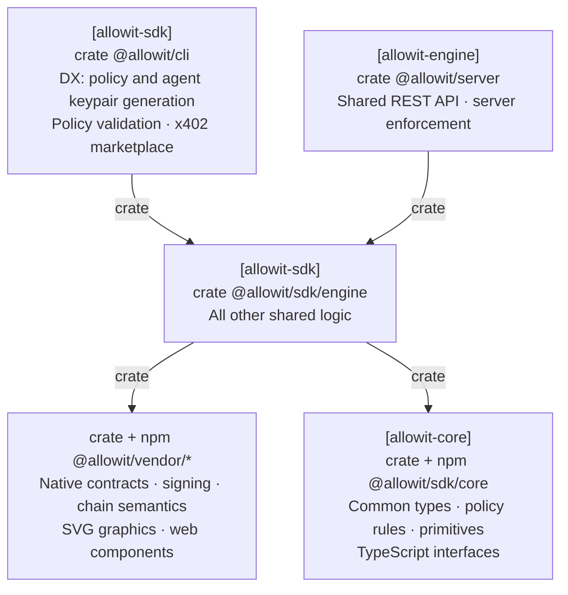

# Allowit SDK

**Go on. On your terms.**

This repository contains `allowit-sdk-engine`, the shared offchain execution library, and the `allowit` CLI.
Both CLI and server callers use SDK engine. Each actor retains its own keys, authorization and durable application state.

[Allowit core](https://github.com/allowit-hq/allowit-core) contains the portable `allowit` policy library, its shared source gate and feature-gated host primitives.
[Stellar rail core](https://github.com/allowit-hq/allowit-contracts-stellar/tree/main/stellar/core) owns native requests, encoding, signatures, RPC methods, simulation and settlement rules.
SDK engine composes those capabilities into preparation, execution, status and recovery workflows.
The server adds trusted policy context, admission, server authority, reservations and accounting.

## Architecture

This repository owns the CLI and SDK engine. The CLI owns developer workflows and client validation.
SDK engine owns other shared logic for CLI and server callers. The CLI also calls the server through REST.



[Full architecture][responsibility-model].

## Run the CLI

Install [Rust](https://rustup.rs) 1.98 or later, then:

```sh
git clone https://github.com/allowit-hq/allowit-sdk.git
cd allowit-sdk
cargo run --locked --bin allowit -- --help
cargo build --locked --release --bin allowit
```

The [CLI reference](cli/README.md) describes owner-authenticated draft generation, local keys, public wallet profiles and agent execution.

```sh
allowit rail use stellar:testnet
allowit keys import agent agent.key
allowit keys use agent
allowit exec --op transfer --to GDEST… --amount XLM:5 --request-id pay-0001
allowit status pay-0001 --wait 60s
```

`ALLOWIT_STELLAR_BUNDLE` names the owner's public wallet profile and `ALLOWIT_URL` selects the server origin.
The profile contains public bindings, never a signing seed. The selected key must match its agent before any request or signature.
An uncertain operation retains its original request ID and signed bytes. Read its status before authorizing another operation.

## Write a portable policy

Policies are synchronous Rust against the `allowit` package:

```rust
use allowit::prelude::*;

pub fn execute(ctx: &AllowitContext) -> allowit::Result {
    allowit::daily_spending_limit(ctx, &ctx.params[allowit::DAILY_SPENDING_LIMIT])?;
    allowit::payment_limit(ctx, &ctx.params[allowit::PAYMENT_LIMIT])?;
    Ok(())
}
```

The host and Soroban contract use the same source. Owner-approved params supply the exact limits in base units.
Request amounts, native identity, accounting and enrichment come from the executing host and rail.
Policy source cannot provide its own trusted spending state.

The [template](cli/templates/policy/) is an ordinary Cargo crate with this policy:

```sh
cargo test --locked -p allowit-policy-template
allowit policy check cli/templates/policy/src/policy.rs
allowit policy build cli/templates/policy/src/policy.rs -o wallet.rs
```

`policy check` validates portable source structure and prints its exact source digest, canonical prefix and state-write shape.
`policy build` type-checks the source through the embedded Core host compiler before emitting it. Cargo also type-checks the policy crate.
The shared host build gate compiles the same source against the exact portable library before an installation can authorize it.
See the [portable policy reference](docs/policy-reference.md) for source restrictions and wallet tiers.

## Embed SDK engine

[`engine/`](engine/) contains shared workflows without terminal I/O:

- `stellar::Runtime` composes native preparation, required durable retention, submission and recovery.
- `stellar::owner_client` validates owner sign-in, binds its private session to the backend and Origin, and generates a portable draft with an explicit template or installation selection.
- `stellar::client` implements the authenticated server protocol, exact-intent resumption and receipt validation. Callers pass their signer capability and a private core `Store`.
- `typed_request` bounds document ingress and derives the versioned operation identity.
- `wallet`, `routing` and `config` supply explicit caller bindings and Stellar network selection.

Authorization is retained before post-authorization RPC simulation. Signed proof is retained before transmission.
A failed policy-wallet envelope does not prove that its reusable address authorization cannot execute in another envelope.
Unknown outcomes preserve their identity and reservation.

Core HTTP and JSON-RPC primitives supply bounds, deadlines and single-attempt transport.
Rail semantics determine whether exact retained bytes remain valid. SDK engine applies those rules to caller-owned journals.
Provider delivery is separate from native chain settlement.

## Repository map

| Path | Purpose |
| --- | --- |
| [`engine/`](engine/) | Shared execution library for CLI, server and SDK callers |
| [`cli/`](cli/) | Commands, input/output, local key custody and configuration |
| [`cli/templates/policy/`](cli/templates/policy/) | Portable policy crate |
| [`cli/skills/allowit/`](cli/skills/allowit/SKILL.md) | Policy authoring instructions |
| [`docs/policy-reference.md`](docs/policy-reference.md) | Portable source and execution contract |

All packages share one Cargo workspace, lockfile and version. Packages in this repository depend on each other by path.
Dependencies from other repositories use release tags. Core and rail dependencies must resolve the same core release.
Published tags are immutable.

## Develop

```sh
cargo build --workspace --all-targets --locked
cargo fmt --all --check
cargo test --locked -p allowit-sdk-engine -p allowit-cli -p allowit-policy-template
cargo clippy --locked -p allowit-sdk-engine -p allowit-cli --all-targets -- -D warnings
```

The affected [workflows](.github/workflows/) define the required checks.

## License

SDK-authored code is under the [MIT License](LICENSE). Dependencies keep their own terms, including the portable `allowit` package.

[responsibility-model]: https://github.com/allowit-hq/allowit-project/blob/main/wiki/allowit/architecture.md#dependency-direction
