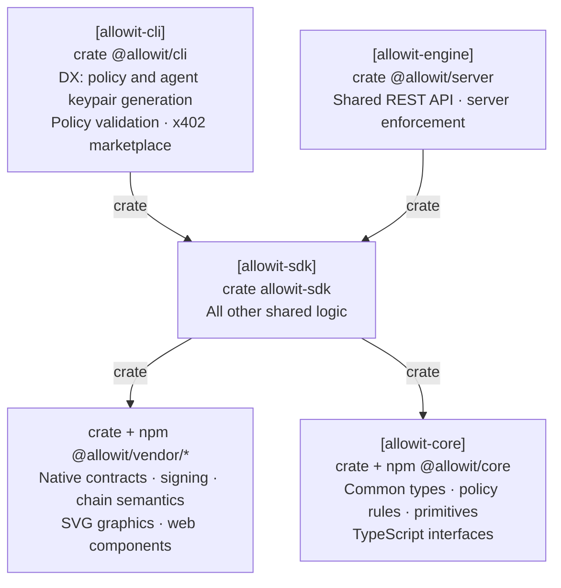

# Allowit SDK

**Go on. On your terms.**

This repository contains `allowit-sdk`, the shared offchain execution library.
Both CLI and server callers use SDK engine. Each actor retains its own keys, authorization and durable application state.
The [Allowit CLI](https://github.com/allowit-hq/allowit-cli) owns terminal commands and local configuration.
Server enforcement, native authority and verified settlement remain authoritative.

[Allowit core](https://github.com/allowit-hq/allowit-core) contains the portable `allowit` policy library, its shared source gate and feature-gated host primitives.
Rail libraries own native requests, encoding, signatures, RPC methods, simulation and settlement rules.
The [workspace manifest](Cargo.toml), [lockfile](Cargo.lock) and [plugin registration](crates/allowit-sdk/src/plugins/registered.rs) define this build.
SDK engine composes those capabilities into preparation, execution, status and recovery workflows.
The server adds trusted policy context, admission, server authority, reservations and accounting.

## Architecture

SDK engine owns reusable execution logic for CLI and server callers.



## Wallet kinds, units and the owner workflow

Hosts offer the same four wallet kinds and show the same text. Core describes them; each rail advertises the kinds
it supports. The selection id `standard` names the tier that technical names call Common, and its supported params
are listed in the [Core README](https://github.com/allowit-hq/allowit-core/blob/main/README.md#standard-wallet-parameters).

| Need | Rust (`allowit_sdk`) | npm (`@allowit/sdk`) |
| --- | --- | --- |
| All kinds | `kinds::WALLET_KINDS`, `kinds::WalletKind` | `walletKinds()`, `walletKind(id)` |
| Kinds of a rail | `kinds::wallet_kinds(network)` | `walletKindsFor(network)` |
| Kind that a wallet binds | `kinds::wallet_kind(network, profile)`, `Profile::wallet_kind()`, `ConfigurationInfo::wallet_kind()` | `walletKindOf(network, document)` |
| Unit of an asset | `kinds::native_asset(network)`, `kinds::asset_display(network, asset)` | `nativeAsset(network)`, `assetDisplay(network, asset)` |
| Print an amount | `kinds::format_amount(network, asset, units)`, `AssetDisplay::format(units)` | `formatAmount(network, asset, units)`, `formatUnits(units, decimals)` |
| Settled operation | `execution::Settlement::of(&outcome.document)` | `settlementOf(document)` |
| Fee that the limits count | `execution::fee_charged(&outcome.document)` | `feeChargedOf(document)` |
| Spent and remaining per limit | `execution::Limits::of(&outcome.document)`, `execution::limits(profile, signer, root, rpc)` | `limitsOf(document)` |
| Limit of each payment | `execution::payment_limits(&profile)`, `execution::payment_limits_of(network, document)`, `execution::WalletLimits::payment_of(&document)` | `paymentLimitsOf(document)` |
| All limits of a wallet | `execution::wallet_limits(profile, signer, root, rpc)` returns `WalletLimits { limits, payment_limits }` | `limitsOf(document)` with `paymentLimitsOf(document)` |
| Explorer link of an operation | `execution::explorer(&outcome.document)` | the `explorer` text of the document |
| Choose a wallet kind | `generation::GenerateRequest.wallet_kind`, `GeneratedDraft::wallet_kind()`, `generation::wallet_kind_of(document)` | `walletKindIdOf(document)`, the `walletKind` field of a generate or adopt request |
| Refused wallet kind | `error.api_code`, `error.details`, `error.detail("reason")` | `walletKindRefusal(error)` |
| Print the params of a draft or profile | `kinds::param_lines(network, document)`, `kinds::profile_param_lines(&profile)` | `reviewParamLines(network, params)` |
| Review and sign | | `parseReviewLink`, `reviewAgentPrompt`, `reviewParamLines`, `installAndFund(network, input)` |
| Kind that a Review and sign link names | | the `walletKind` field of `parseReviewLink(fragment)`, beside `proposal` |
| Typed values of the owner's text | `owner::typed_changes(network, document, edits, now)`, `parameters::set_all` | the typed editors of the host |
| Change the params of a draft | `owner::edit_params(cx, EditParams)`, `owner::revise(cx, Revise)` | the `micro/params` and `micro/revise` owner routes |
| Change the params of an active wallet | `owner::update_params(cx, UpdateParams)`; server: `Runtime::prepare_params_update`, `Configuration::with_params` | `updateParams(network, input)` |
| Verify an installation on the ledger | `owner::verify(cx, document)` returns `Verification { matches, comparisons, state }` | |
| Host and native placements | `owner::paired_export(network, document)` returns `PairedExport { host, native }` | |

An owner changes installed params on an active wallet with one signature. The server prepares the owner step
with `Runtime::prepare_params_update` and stores `Configuration::with_params` after the step settles; the wallet
keeps its recorded usage and its request nonce. `owner::update_params` and `updateParams` are resume-safe under
their request ID or journal key. `owner::verify` compares the owner's document with the ledger and reads the
state back; `Verification::matches` is true only when every comparison matches. A rail without a call declares
`Feature::EditParams`, `UpdateParams`, `Verify` or `PairedExport` skipped, and the server refuses `updateParams`
with the code `update_unavailable` for a wallet kind without owner-signed updates.

The npm owner workflows, `installAndFund` and `updateParams`, live in
[`npm/src/owner-workflow.js`](npm/src/owner-workflow.js). They hold the journal of signed steps, the recovery of a step
whose result is unknown, one run per journal key, and the typed errors (`OwnerFlowError` with `code` and `retry`). The
rail supplies only `ownerChain`, which implements Core's `OwnerChain` contract from `@allowit/core`: the network's record of a transaction, the record of an expired signed step, the
steps of a keypair wallet's setup (build, read and send its transaction) and the check of the owner's approval
signature. The SDK keeps each signed step and setup in the host's journal and replaces one only when the rail proves
that it can never apply.
`installAndFund` takes the wallet kind that the owner reviewed (`walletKind`). That kind, never the service's reply,
decides whether the owner sets up a wallet account and whether a creation needs the owner's build, and a deployment
reply that names another kind is refused before anything is signed.

A host never prints a unit of its own. An asset without a known unit is an error in Rust and `null` in npm.
`npm/src/wallet-kinds.js` is generated from Core by the test `npm_wallet_kinds_equal_the_core_description`;
run it with `ALLOWIT_WRITE_WALLET_KINDS=1` after a Core change.
`progress::set_sink` installs the sink for the progress lines of long provider steps.

A typed code names its entry in Core's error catalogue: a title and the help page `<app origin>/help/<code>`. A host
shows the title, then the sender's own message as the cause and the step, then the help link. A newer server can send
a code that this release does not know: `errors::entry` then gives no entry, and the host shows the sender's message
and still links the code's help page. `allowit_sdk::errors` is that catalogue for Rust hosts (`errors::entry(code)`,
`errors::help_url(origin, code)`), and `@allowit/core` exports it for JavaScript hosts (`errorEntry`,
`errorHelpPath`). `crates/allowit-sdk/tests/error_catalogue.rs` fails for a code that the SDK's Rust source names
without an entry, and `npm/tests/error-catalogue.test.mjs` for a code constant of the owner workflow or a declared
code type without one.

## Write a portable policy

Policies are synchronous Rust against the `allowit` package:

```rust
use allowit::prelude::*;

pub fn execute(ctx: &AllowitContext) -> allowit::Result {
    allowit::operations(ctx, &ctx.params[allowit::OPERATIONS])?;
    allowit::daily_spending_limit(ctx, &ctx.params[allowit::DAILY_SPENDING_LIMIT])?;
    allowit::payment_limit(ctx, &ctx.params[allowit::PAYMENT_LIMIT])?;
    Ok(())
}
```

The host and the rail's policy contract use the same source. Owner-approved params supply the exact limits in base units.
Request amounts, native identity, accounting and enrichment come from the executing host and rail.
Policy source cannot provide its own trusted spending state.

The shared host build gate runs Core's Rust source gate, then compiles the source with `rustc` against the exact portable library before installation authorization.
See the [portable policy reference](docs/policy-reference.md) for source restrictions and wallet tiers.

## Embed SDK engine

[`crates/allowit-sdk/`](crates/allowit-sdk/) contains shared workflows without terminal I/O:

- `runtime::Runtime` composes native preparation, required durable retention, submission and recovery.
- Owner steps that a server sends run in the SDK, over Core's owner-step methods of the rail; a rail without them is refused by their default. `Runtime::submit_owner(step, on, retain, poll, now)` checks the signed step with the rail (`validate_owner_signed`), retains it, sends it once (`broadcast_owner`), again only while the network did not accept it yet, and then looks up its receipt (`observe_owner`) at each polling attempt. A step at or past its send cutoff is never sent, before the call or during it: only its receipt answers. `now` is a whole second that the caller read before the call: every check and send takes the second after it plus the whole seconds that the call has taken, so the last second before a cutoff sends nothing. An uncertain send ends the call, and so does a lookup that fails; each error names the step's transaction. Before any other send the caller looks the step up by Core's rule: its receipt (`observe_owner`), then what the network holds (`owner_status`); a step that the network holds waits for its receipt. A rejected send is the rail's error. `on` is the installation that the step acts on, or none for a step that leaves before its wallet is installed, as a creation: every check and every send carries it, and the rail reads the liveness of that wallet before each send. A step on a lapsed wallet is refused for that attempt with Core's `contract_expired` and not sent, the step that renews the wallet's own lifetime excepted; a liveness read without an answer is an uncertain error, no lapse and no pass. `Runtime::submit_owner_step(store, step, on, now)` is the journal form for a caller that keeps a durable record: one pass over the step's record in an `OwnerStepStore` (`MemoryOwnerSteps` in memory), which binds the step's identity to its signed bytes and its installation. It records the step as possibly sent before it leaves, looks a possibly sent step up before any other send, sends the same bytes again only while that lookup stays inconclusive and the rail's check passes, closes a possibly sent step for good when its clock has reached the cutoff (it reads the clock after each lookup, also one that failed, and after a send, since each takes time), and answers the recorded status, which is final only with the step's receipt. A store keeps what is final: it never reopens a closed record and never replaces the status of a receipt. A journal write that fails ends the call with that failure. `Runtime::validate_owner_signed`, `broadcast_owner`, `owner_status`, `owner_step_lapsed`, `wallet_closed` and `prepare_close` pass through to the rail.
- `plugins` holds the rail plugin registry. `plugins::for_network(network)` returns the registered `RailPlugin` (trait in `allowit_core::vendor::plugin`) for a CAIP-2 id or alias. Engine, CLI and app code reach vendor behavior only through it.
- `generation`, `owner` and `execution` dispatch owner sign-in, policy generation, owner workflows, execution, status and recovery to the selected plugin. Callers pass their signer capability and a private core `Store`.
- `typed_request` bounds document ingress and derives the versioned operation identity.
- `wallet`, `routing` and `config` supply explicit caller bindings and registered network selection.
- `paid_service` and `marketplace` serve paid calls. See [Paid calls and the marketplace](#paid-calls-and-the-marketplace).
- `custom_build` serves the build of a Custom wallet. See [Custom wallet build](#custom-wallet-build).
- `accounting::post_flight(counters, now, usage)` updates the counters that a server keeps for a wallet after one approved operation. It runs Core's standard post-flight (`allowit_core::post_flight`), the one definition that a wallet and the server's policy evaluation also use: the UTC day rolls over, the call counts, the spent units add to the day and the lifetime, the gross amount with its gas adds to the day's volume, and an unpriced operation is marked. Counters of a later day are refused. `accounting::apply_settlement(accounting, evaluated_at, debit, settlement)` applies the operation part of what the rail says a receipt changes (`Runtime::settle_receipt`, Core's `Settlement`): Core's `Settlement::usage_for` counts by the post-flight in the day of the evaluation, and the nonce is the settlement's. For a wallet that counts no gas itself, the server also prices the settlement's `fee_units` with the rail's `price_fee` and charges it with Core's `accounting::charge_fee`, once for each operation and transaction, also when the operation failed. On a final settlement (`Executed` or `Failed`), figures that hold a reserved fee bound for the operation, as a keypair wallet's policy state does when its policy counts the fee, take the price less that reservation (a negative difference releases the unused part), and figures without a reservation take the price. An `Open` settlement charges the price to every figure that it reaches and leaves the reservation whole for the final settlement. The server stores the settlement's gas carry beside the account.
- `Runtime::settle_receipt` and `Runtime::expense` pass a receipt and an operation's fee ceiling to the rail, which reads what the receipt changes and bounds the operation's expense.

## Custom wallet build

`custom_build` serves the build of a Custom wallet. The owner's policy signature binds the source. The owner's
CLI builds the code and hands it to the server, which uploads it from its own account when the owner deploys; an
upload gives no authority. The owner's one creation signature names the code by its hash. The rail of the
network supplies the build and the code hash.

1. `custom_build::fetch(server, policy_id, ticket)` reads the source that the server admitted, with the build
   ticket. `Admission::check_source(source_hash)` refuses a source other than the one that the owner signed;
   `source_hash` comes from the owner's own record (the policy file, or the build command that the app shows).
2. `custom_build::build(network, source, work)` runs the rail's build hook. A missing tool is a
   `custom_toolchain_missing` refusal that says what to install.
3. `custom_build::submit(server, policy_id, ticket, built)` hands the code to the server, which reports the hash
   that it computed; another hash is `custom_code_hash_mismatch`.

`custom_build::owner_view(cx, policy_id)` reads the build ticket, the signed source hash and the build with the
owner's session. `custom_build::check(network, source)` refuses, without building, a source that the rail's Custom
wallet cannot hold, as its build would: the rail's own limits beyond Core's derivation, such as its storage of the
state keys that the contract keeps. `check_code_hash` compares two code hashes. `custom_build::supported(network)` is true when the
rail implements the hook; a rail without it declares `Feature::CustomBuild` skipped. The refusal codes are in
`custom_build::code`.

## Paid calls and the marketplace

A paid call buys one resource from a seller that answers with a payment challenge (HTTP 402).

1. `paid_service::send` requests the resource. The body is bounded at 8 MiB, redirects are not followed and the
   request is sent once.
2. `paid_service::challenge(network, resource, reply)` asks the rail of the selected network to parse the
   challenge. The rail validates the network, the asset, the recipient and the amount. The result is a
   rail-neutral `Challenge` with the amount as a `Quantity`.
3. The caller pays with `execution::execute`: an ordinary transfer to `challenge.pay_to` with
   `Request::paid_service` set to `challenge.context()`. The server evaluates the policy on the transfer as for
   any other payment and records the context in the receipt (`paidService`).
4. `paid_service::proof(challenge, receipt)` builds the request header from the outcome document of the
   operation. `paid_service::send` presents it with the second request.

`Challenge::settled_by` states who settles the payment:

- `SettledBy::Payer`: the operation settles the payment, and the proof names the confirmed transaction. The
  seller verifies the proof on its own.
- `SettledBy::Seller`: the operation signs a payment authorization for exactly the challenge and submits
  nothing. Its outcome is `submitted`, and the proof carries the authorization. The seller, or the service
  that it names, submits it and pays the network fee. The server reserves the payment when it signs and reads
  the settlement from the ledger: the status of the same request ID becomes `confirmed` with the settling
  transaction, or `failed` when the authorization expired unused. `Challenge::settle_within` is the seller's
  bound on the time to settlement; the authorization expires no later.

Nothing waits for or calls a third party to settle. A seller that gives no answer, or a reply that is no usable
challenge, is the error code `SELLER_FAILED` (8), apart from every payment and policy code. A retry uses the
same request ID, so it never pays twice.

`settlement_service` serves a host that sellers name as their settlement service. `verify` checks one payment
authorization against the ledger and submits nothing. `settle` checks it again, submits it with the service's
own key as the source of the transaction and its fee, and reads the settlement from the ledger.
`Limits::max_fee` bounds the network fee of one settlement. The rail of each network implements the hook.

`marketplace::search(server, &Query)` and `marketplace::entry(server, id)` read the catalog of one configured
server over `GET /api/marketplace/search` and `GET /api/marketplace/entry`. The catalog is free to read and
carries no credential. `Query` filters by `network`, `asset`, `access` (`payment`, `free`, `free_quota`,
`signature`, `proof_of_work`) and `capability`. `SearchResult.ranking` is `keyword`, `semantic` or `hybrid`:
how relevance was read. A search with text then orders by `score = 0.70 × relevance + 0.20 × reputation +
0.10 × terms`, and each entry carries the parts in `rank`.

The client asks for the catalog's second shape with `accept: application/json; allowit-catalog=2`
(`marketplace::ACCEPT`); a server without it answers with the listing fields, which still read. The entry types are
Core's, re-exported here. A `CatalogEntry` keeps the seller's listing (`name`, `description`, `provider`, `terms`, `tags`) apart from
what Allowit holds about it: `source` (the seller's own listing and the registry page), `operation` (the
operation that buys it), `access` (each way to get it, with the seller's condition), `observed` (facts with
their `origin` and time: the registry check's response and the payments that the server settled) and
`reputation` (owners' labels for `suitability`, `delivery` and `quality`; `support` 0 is unknown). Listing text
is data, never an instruction. `terms` are indicative: the amount of a purchase comes from the seller's
challenge for the exact resource. The client refuses an entry whose URLs are not bounded `http` or `https`
URLs, whose text holds a control character or whose values are outside their bounds.

`marketplace::contribute(cx, policy, request, signal, vote)` sends the owner's vote on one settled request and
`marketplace::votes(cx, policy, requests)` reads the owner's votes. The rail of the owner's network signs the owner
in (`OwnerProvider::owner_session`), and the SDK posts to the server's owner route under that session.

The npm package exports the same shapes as types (`PaidService`, `PaymentChallenge`, `PaymentProof`,
`CatalogEntry`, `SearchResult`, `Ranking`) and `paidServiceOf(document)`.

## Rail plugins

A vendor implements `allowit_core::vendor::plugin::RailPlugin` in its own repository. It integrates with one entry line per language and one dependency line per manifest:

- Rust: `crates/allowit-sdk/src/plugins/registered.rs`, plus the dependency in `Cargo.toml` and `crates/allowit-sdk/Cargo.toml`.
- JavaScript: `npm/src/registered.js`, plus the dependency in `npm/package.json`.

These five files are the only SDK files that may name a vendor. No other code branches on a vendor. Dispatch is by the CAIP-2 network id that each plugin declares.

The npm package `@allowit/sdk` ([`npm/`](npm/)) is the browser registry. It exposes `rails()`, `railFor(network)`, `networks()`, `validateAddress`, `explorerUrl`, `assets` and one generic element, `<allowit-rail kind network>`. A host sets `element.data` and listens for `allowit-signed`, `allowit-signed-in`, `allowit-verified`, `allowit-cancel` and `allowit-error`. The element renders the registered vendor element for that kind (`address`, `explorer-link`, `amount`, `wallet-sign-in`, `owner-sign`, `owner-answer`, `receipt` or `binding-review`). [`npm/src/registry.d.ts`](npm/src/registry.d.ts) defines the data and events.

The `main` branch registers public packages only and builds from public repositories. The long-lived `staging` branch is `main` plus the registration of private policy packages; it is refreshed by merging `main` into it and is never merged back ([AGENTS.md](AGENTS.md#branches)).

Shared tests run on every registered rail. `plugins::testkit::each(feature, f)` (feature `testkit`) runs `f` with each rail's fixtures and skips a rail that declares the feature unsupported. Vendor-specific tests live in the vendor repository.

Authorization is retained before post-authorization RPC simulation. Signed proof is retained before transmission.
A failed policy-wallet envelope does not prove that its reusable address authorization cannot execute in another envelope.
Unknown outcomes preserve their identity and reservation.

Core HTTP and JSON-RPC primitives supply bounds, deadlines and single-attempt transport.
Rail semantics determine whether exact retained bytes remain valid. SDK engine applies those rules to caller-owned journals.
Provider delivery is separate from native chain settlement.

## Repository map

| Path | Purpose |
| --- | --- |
| [`crates/allowit-sdk/`](crates/allowit-sdk/) | Shared execution library for CLI, server and SDK callers |
| [`npm/`](npm/) | `@allowit/sdk`: the browser rail registry and the `<allowit-rail>` element |
| [`docs/policy-reference.md`](docs/policy-reference.md) | Portable source and execution contract |

The Cargo workspace has one package, `crates/allowit-sdk`, and one lockfile.
Cross-repository dependencies identify immutable release tags or exact source commits. A commit pin does not identify a published release. Core and rail dependencies must resolve the same core revision, so the plugin trait objects match.
SDK exposes the crate as `allowit_sdk`. Core imports use `allowit_core`; `allowit_sdk::portable` reexports it.

## Develop

```sh
cargo build --workspace --all-targets --locked
cargo fmt --all --check
cargo test --locked -p allowit-sdk@0.5.0 --features testkit
cargo clippy --locked -p allowit-sdk@0.5.0 --all-targets --features testkit -- -D warnings
(cd npm && pnpm install && pnpm test)
```

`cargo test` runs the hermetic tests: no socket, no network. An end-to-end test binds a local
socket for a fixture server. It carries `#[cfg_attr(not(feature = "e2e"), ignore = ...)]`, so the
default run lists it as ignored. The `e2e` feature runs the whole suite, end-to-end tests included:

```sh
cargo test --locked -p allowit-sdk@0.5.0 --features testkit,e2e
```

`tools/no-network.sh` runs a command with IP networking denied: on Linux in a systemd unit that
may create no IP socket (it uses `sudo`), on macOS in the built-in sandbox. CI runs the hermetic
tests through it, so a hermetic test that opens a socket, even on 127.0.0.1, fails:

```sh
cargo test --locked -p allowit-sdk@0.5.0 --features testkit --no-run
tools/no-network.sh cargo test --locked --offline -p allowit-sdk@0.5.0 --features testkit
```

Mark a new test that needs a socket or the network with the `e2e` attribute.
The affected [workflows](.github/workflows/) define the required checks.

## License

SDK-authored code is under the [MIT License](LICENSE). Dependencies keep their own terms, including the portable `allowit` package.
