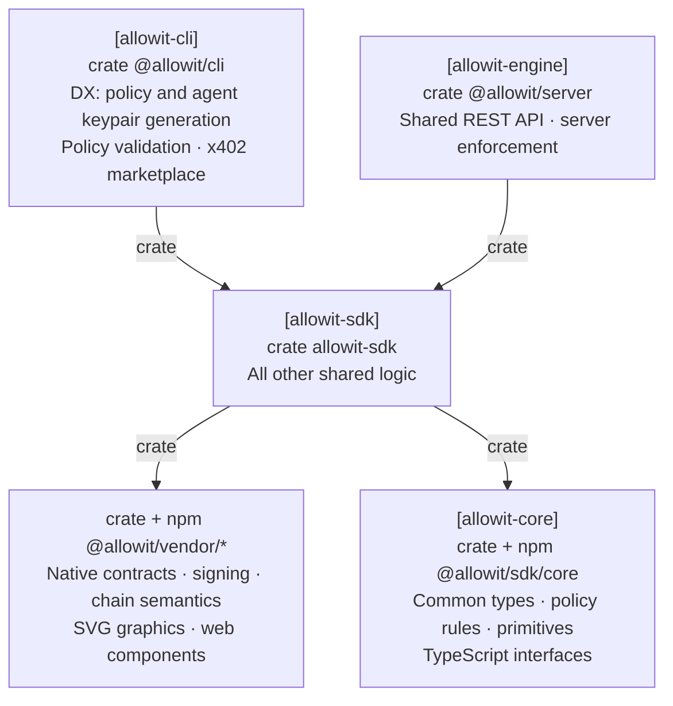

# Allowit SDK

**Go on. On your terms.**

This repository contains `allowit-sdk`, the shared offchain execution library.
Both CLI and server callers use SDK engine. Each actor retains its own keys, authorization and durable application state.
The [Allowit CLI](https://github.com/allowit-hq/allowit-cli) owns terminal commands and local configuration.
Server enforcement, native authority and verified settlement remain authoritative.

[Allowit core](https://github.com/allowit-hq/allowit-core) contains the portable `allowit` policy library, its shared source gate and feature-gated host primitives.
Rail libraries own native requests, encoding, signatures, RPC methods, simulation and settlement rules.
The [workspace manifest](Cargo.toml), [lockfile](Cargo.lock) and [rail table](crates/allowit-sdk/src/routing.rs) define this build.
SDK engine composes those capabilities into preparation, execution, status and recovery workflows.
The server adds trusted policy context, admission, server authority, reservations and accounting.

## Architecture

SDK engine owns reusable execution logic for CLI and server callers.



[Full architecture][responsibility-model].

## Write a portable policy

Policies are synchronous Rust against the `allowit` package:

```rust
use allowit::prelude::*;

pub fn execute(ctx: &AllowitContext) -> allowit::Result {
    allowit::operations(ctx, &ctx.params[allowit::OPERATIONS])?;
    allowit::daily_spending_limit(ctx, &ctx.params[allowit::DAILY_SPENDING_LIMIT])?;
    allowit::payment_limit(ctx, &ctx.params[allowit::PAYMENT_LIMIT])?;
    Ok(())
}
```

The host and Soroban contract use the same source. Owner-approved params supply the exact limits in base units.
Request amounts, native identity, accounting and enrichment come from the executing host and rail.
Policy source cannot provide its own trusted spending state.

The shared host build gate compiles source against the exact portable library before installation authorization.
See the [portable policy reference](docs/policy-reference.md) for source restrictions and wallet tiers.

## Embed SDK engine

[`crates/allowit-sdk/`](crates/allowit-sdk/) contains shared workflows without terminal I/O:

- `runtime::Runtime` composes native preparation, required durable retention, submission and recovery.
- `vendors::stellar::runtime::owner_client` validates owner sign-in, binds its private session to the backend and Origin, and generates a portable draft with an explicit template or installation selection.
- `vendors::stellar::runtime::client` implements the authenticated server protocol, exact-intent resumption and receipt validation. Callers pass their signer capability and a private core `Store`.
- `typed_request` bounds document ingress and derives the versioned operation identity.
- `wallet`, `routing` and `config` supply explicit caller bindings and registered network selection.

Authorization is retained before post-authorization RPC simulation. Signed proof is retained before transmission.
A failed policy-wallet envelope does not prove that its reusable address authorization cannot execute in another envelope.
Unknown outcomes preserve their identity and reservation.

Core HTTP and JSON-RPC primitives supply bounds, deadlines and single-attempt transport.
Rail semantics determine whether exact retained bytes remain valid. SDK engine applies those rules to caller-owned journals.
Provider delivery is separate from native chain settlement.

## Repository map

| Path | Purpose |
| --- | --- |
| [`crates/allowit-sdk/`](crates/allowit-sdk/) | Shared execution library for CLI, server and SDK callers |
| [`docs/policy-reference.md`](docs/policy-reference.md) | Portable source and execution contract |

All packages share one Cargo workspace, lockfile and version. Packages in this repository depend on each other by path.
Cross-repository dependencies identify immutable release tags or exact source commits. A commit pin does not identify a published release. Core and rail dependencies must resolve the same core release.
Published tags are immutable.
The `allowit-core` dependency alias selects the released Core host package `allowit-sdk` at `v0.3.1`.
SDK exposes the crate as `allowit_sdk`. Core host imports use `allowit_core`.
Adopting the consolidated Core `allowit-core` package requires matching Core and rail releases.

## Develop

```sh
cargo build --workspace --all-targets --locked
cargo fmt --all --check
cargo test --locked -p allowit-sdk@0.5.0
cargo clippy --locked -p allowit-sdk@0.5.0 --all-targets -- -D warnings
```

The affected [workflows](.github/workflows/) define the required checks.

## License

SDK-authored code is under the [MIT License](LICENSE). Dependencies keep their own terms, including the portable `allowit` package.

[responsibility-model]: https://github.com/allowit-hq/allowit-project/blob/main/wiki/allowit/architecture.md#dependency-direction
