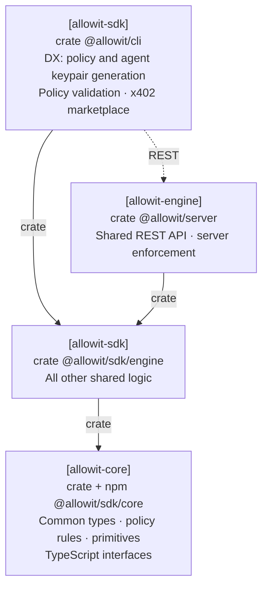

# Allowit CLI

The `allowit` command owns developer workflows, local key custody, portable drafts, wallet profiles and agent requests.
[`allowit-sdk-engine`](../engine/) supplies reusable workflows for CLI and server callers.
Rail core owns native encoding, signing, simulation and settlement semantics.
[Allowit core](https://github.com/allowit-hq/allowit-core) supplies deterministic policy logic and host transport and journal primitives.
The server supplies trusted policy enforcement and its own signing authority.

```sh
cargo run --locked --bin allowit -- --help
cargo build --locked --release --bin allowit
```

## Architecture

The CLI owns developer workflows for policies, agent keypairs, validation and the x402 marketplace.
It uses SDK engine for shared logic and the server REST API for server operations.



Solid arrows are dependencies. Dashed arrows are runtime calls / connections.
This view follows the [canonical responsibility diagram][responsibility-model].
Use the [Cargo manifest](Cargo.toml) for Rust build package names.

## Commands

```
allowit rail ls | show [RAIL] | use RAIL
allowit keys generate NAME [--fund]
allowit keys add NAME --public-key GADDR
allowit keys import NAME FILE|-
allowit keys use NAME
allowit keys ls | show NAME | fund NAME | export NAME | rm NAME
allowit config show | path
allowit wallet ls | show | use ADDR
allowit policy generate --owner-key NAME --origin ORIGIN --profile PROFILE (--new-wallet | --installation ID) PROMPT
allowit policy show [--source]
allowit policy check POLICY.rs
allowit policy build POLICY.rs [-o OUT]
allowit exec --op transfer --to GDEST… --amount XLM:5 --request-id pay-0001
allowit status pay-0001 --wait 60s
allowit history
allowit guide
```

`stellar:testnet` and `stellar:pubnet` select separate wallet and key settings.
`stellar:mainnet` is an alias for `stellar:pubnet`.
Private Stellar S seeds remain in `secrets/NAME` with mode 0600 inside a 0700 directory.
`keys use` selects an existing private key for that network. It performs no server registration.
Public keys added with `keys add` cannot sign. `keys export` explicitly prints a private seed.

## Generate an owner policy

Select the network and import the owner key by name. Generation does not change the selected agent key.
`ALLOWIT_URL` names the backend; `--origin` names an Origin allowed by that backend for owner sign-in.

```sh
allowit rail use stellar:testnet
allowit keys import owner owner.key
allowit --json policy generate --owner-key owner --origin http://localhost:5173 \
  --profile allowit-stellar-policy-wallet-v1 --new-wallet \
  'Pay only my approved recipient, up to 1 XLM per payment'
```

The shared SDK client validates the exact sign-in message before requesting an owner signature.
Its session stays in memory and is bound to that backend, Origin and owner account.
`--new-wallet` requires an advertised contract-wallet template. To use an existing owner installation,
replace it with `--installation ID` and that installation's advertised profile. Selection never falls back between them.
The complete prompt, selected network, profile and transfer operation go to the server.

The result is a public portable draft with exact source and typed owner params. Exit 11 means that owner input remains unresolved.
Generation does not deploy, fund or activate a wallet. Its build report does not authorize publication.
After uncertain generation (exit 5), inspect the owner workspace before submitting another generation; the CLI sends no automatic retry.

## Stellar agent requests

The owner supplies the public wallet profile in `ALLOWIT_STELLAR_BUNDLE`.
It names the wallet, owner, agent, server, installed asset and engine endpoints.
It contains no signing material. `ALLOWIT_URL` selects the server origin.

```sh
allowit rail use stellar:testnet
allowit keys import agent agent.key
allowit keys use agent
allowit exec --op transfer --to GDEST… --amount XLM:5 --request-id pay-0001
allowit status pay-0001 --wait 60s
```

The selected agent key must match the profile before transport or signing.
`exec` builds and validates a typed native or SEP-41 transfer for the installed asset.
Policy wallets also accept SEP-56 vault deposits and redemptions with `--token-out` minimums.
`--build-only` prints the typed request and sends nothing.
Amounts use `CODE:DECIMAL`, `CODE:ISSUER:DECIMAL`, `C…:DECIMAL` or integer base units.
`XLM` and `native` identify the same asset.

The CLI journals each operation before sending it. An uncertain result retains its request ID and exact bytes.
Repeat the same `exec` or read `status`; a new request ID represents a new operation.
Terminal status requires a verified receipt. A rotated agent key can recover an original receipt without signing again.
Policy wallet signing revalidates the prepared operation through `--rpc-url URL` or the rail's `rpc_url` setting.
This RPC receives only public observations and unsigned simulation bytes.
Classic execution and signed recovery require no RPC override.

The hidden `wallet configure` and `wallet approve` commands produce browser signing links for Stellar Testnet.
`configure` binds the signer-setting operations of a funded classic account.
`approve` binds the policy source, revision, typed params, tier, rules, network and wallet subject.
Both retain their original intent in a working-directory journal and exit 10.

## Output and exits

Data goes to stdout. Diagnostics and generated request IDs go to stderr.
`--json` selects JSON; `NO_DNA` selects compact JSON and disables prompts.
`--build-only` always prints JSON. Destructive commands need `--yes` without a terminal.

| Exit | Meaning |
| --- | --- |
| 0 | Success |
| 1 | Internal error |
| 2 | Invalid command or input |
| 3 | Configuration or unavailable capability |
| 4 | Contract rejection |
| 5 | Uncertain; preserve the request ID |
| 6 | Replayed result |
| 10 | Owner signature needed |
| 11 | Owner input needed |
| 12 | Pending |
| 20 | Policy denial |
| 130 | Interrupted |

## Source layout

- `src/commands/` owns command arguments, examples and terminal interaction.
- `src/vendors/stellar/` adapts the retained native wallet library. `asset.rs` and `address.rs` validate Stellar input.
- `src/settings/` owns caller configuration, private keys and local request records.
- `src/ctx.rs` resolves caller settings. `src/term.rs` renders output.
- [`templates/policy/`](templates/policy/) contains the policy crate; [`skills/allowit/`](skills/allowit/SKILL.md) describes authoring.

Help snapshots live in `tests/snapshots/help/`.
After an intended command change, run `ALLOWIT_UPDATE_SNAPSHOTS=1 cargo test -p allowit-cli --test help`.

## Owner capabilities and native policy binding

The shared Core admin traits describe deployment, pause and full-balance recovery capabilities.
Stellar rail core prepares their exact native arguments, trusted reads and unsigned transactions.
Preparation returns XDR and required authorizers. The caller reviews and signs the exact transaction.
SDK engine controls submission and original-hash recovery; keys remain with the caller.

Portable policy source uses `pub fn execute(ctx: &AllowitContext) -> allowit::Result`.
Owner params supply configuration; authenticated request facts and committed state come from the host and rail.
See the [portable policy reference](../docs/policy-reference.md) and [Stellar rail reference](https://github.com/allowit-hq/allowit-contracts-stellar/tree/main/stellar/core).

[responsibility-model]: https://github.com/allowit-hq/allowit-project/blob/main/wiki/allowit/architecture.md#dependency-direction
