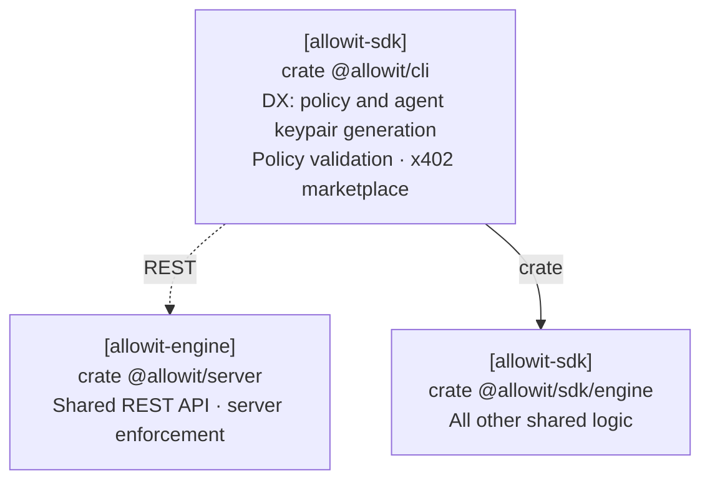

# Allowit CLI

The `allowit` command owns developer workflows, local key custody, portable drafts, wallet profiles and agent requests.
[`allowit-sdk-engine`](../engine/) supplies reusable workflows for CLI and server callers.
Rail core owns native encoding, signing, simulation and settlement semantics.
[Allowit core](https://github.com/allowit-hq/allowit-core) supplies deterministic policy logic and host transport and journal primitives.
The server supplies trusted policy enforcement and its own signing authority.
The CLI owns UX and client-side validation of selections, identities and requests, using shared Core and SDK logic.
Server enforcement and native chain authority remain with their respective components.

```sh
cargo run --locked --bin allowit -- --help
cargo build --locked --release --bin allowit
```

## Architecture

The CLI owns developer workflows for policies, agent keypairs, validation and the x402 marketplace.
It uses SDK engine for shared logic and the server REST API for server operations.



[Architecture](../README.md#architecture).

## Commands

```
allowit rail ls | show [RAIL] | use RAIL | trust ORIGIN PUBLIC_KEY
allowit keys generate NAME [--fund]
allowit keys add NAME --public-key ADDR
allowit keys import NAME FILE|-
allowit keys use NAME
allowit keys ls | show NAME | fund NAME | export NAME | rm NAME
allowit config show | path
allowit wallet ls | show | use ADDR
allowit policy generate --owner-key NAME --origin ORIGIN --profile PROFILE (--new-wallet | --installation ID) PROMPT
allowit policy show [--source]
allowit policy check POLICY.rs
allowit policy build POLICY.rs [-o OUT]
allowit exec --op transfer --to DESTINATION --amount ASSET:5 --request-id pay-0001
allowit status pay-0001 --wait 60s
allowit history
allowit guide
```

## Vendors and build output

The [workspace manifest](../Cargo.toml) selects vendor dependencies. The [lockfile](../Cargo.lock) fixes their source revisions.
The [SDK registry](../engine/src/vendors/mod.rs) selects compiled vendor bindings. Each vendor library supplies its network identities and aliases.
[CLI adapter wiring](src/vendors/mod.rs) calls the shared capabilities. Adding a dependency alone does not make a vendor available.

```sh
allowit version
allowit rail ls --json
allowit rail show RAIL --json
```

Use the installed build's output instead of a copied rail list.
`rail ls` reports identifiers, aliases, family, Testnet status and the current selection.
`rail show` reports supported operations, available/unavailable commands, signing curve, asset metadata and local selections.
Use the selected [adapter's instructions](src/vendors/) for its public profile and native input formats.
Runtime configuration does not install another vendor.
Printed CLI examples use the effective selected rail, then the first rail in build order.
Reading help or the guide does not create settings or inspect private keys.

## Local keys and selections

The CLI stores wallet and key selections separately for each canonical rail identifier.
Private signing material remains in `secrets/NAME` with mode 0600 inside a 0700 directory.
`keys use` selects an existing private key for that network. It performs no server registration.
Public keys added with `keys add` cannot sign. `keys export` explicitly prints private signing material.

## Configure public server trust

Select a rail from `allowit rail ls --json` before configuring its backend identity.
Obtain the public identity through an independent trusted channel.
For a local server, derive it from the actual configured server signer through the launch setup.
A public profile or an unauthenticated discovery response cannot install its own trust anchor.

```sh
allowit rail use RAIL
allowit rail trust SERVER_ORIGIN PUBLIC_KEY
```

The command stores the public identity by rail and origin in `config.toml`, under `server_authorities`.
Repeating the same pin does not change the configuration. It does not create a key or change agent or wallet selection.
The origin must match `ALLOWIT_URL`. Credentials, paths, queries and fragments are not origins.
Imports and owner actions require this independent pin. Fresh execution retains that authority and one exact profile through journaling and signing.

## Generate an owner policy

Select the network and import the owner key by name. Generation does not change the selected agent key.
`ALLOWIT_URL` names the backend. `--origin` names an Origin that the backend allows for owner sign-in.

```sh
allowit rail use RAIL
allowit keys import owner owner.key
allowit --json policy generate --owner-key owner --origin http://localhost:5173 \
  --profile PROFILE --new-wallet \
  'Pay only my approved recipient'
```

The shared SDK client validates the exact sign-in message before requesting an owner signature.
Its session stays in memory and is bound to that backend, Origin and owner account.
`--new-wallet` requires an advertised contract-wallet template. To use an existing owner installation,
replace it with `--installation ID` and that installation's advertised profile. Selection never falls back between them.
Use the exact wallet `PROFILE` advertised by the server for the selected adapter.
The complete prompt, selected network, profile and transfer operation go to the server.
Generated source starts its rule sequence with `allowit::operations`, binding the permitted operation set.
The [authoring contract](../docs/policy-reference.md#authoring-order) defines the order. UI renderers preserve it.

The result is a public portable draft with exact source and typed owner params. Exit 11 means that owner input remains unresolved.
Generation does not deploy, fund or activate a wallet. Its build report does not authorize publication.
After uncertain generation (exit 5), inspect the owner workspace before submitting another generation. The CLI sends no automatic retry.

## Execute and recover

Use `policy export` after activation, or `wallet import FILE --rpc-url URL` for a verified public export from another device.
Then inspect it with `wallet show` and `policy show`.
Each [adapter reference](src/vendors/) describes its public profile configuration and native request formats.
[Known issues](../known_issues.md) describes compatibility with older exports.
`ALLOWIT_URL` selects the server origin for owner requests and profile import.
The SDK retains that origin with each cached profile. Selecting an address does not fetch or import a profile.

Use only commands and operations advertised by `rail show`.
The CLI journals each operation before sending it. An uncertain result retains its request ID and exact bytes.
Repeat the same `exec` or read `status`. A new request ID represents a new operation.
Terminal status requires a verified receipt. A rotated agent key can recover an original receipt without a new operation signature.
Original journal recovery does not require a new profile cache, current source approval or a new authority pin.
It queries the configured settlement service for the original packet and verifies its receipt. It never prepares another payment.

## Output and exits

Data goes to stdout. Diagnostics and generated request IDs go to stderr.
`--json` selects JSON. `NO_DNA` selects compact JSON and disables prompts.
`--build-only` always prints JSON. Destructive commands need `--yes` without a terminal.

| Exit | Meaning |
| --- | --- |
| 0 | Success |
| 1 | Internal error |
| 2 | Invalid command or input |
| 3 | Configuration or unavailable capability |
| 4 | Contract rejection |
| 5 | Uncertain. Preserve the request ID |
| 6 | Replayed result |
| 10 | Owner signature needed |
| 11 | Owner input needed |
| 12 | Pending |
| 20 | Policy denial |
| 130 | Interrupted |

## Source layout

- `src/commands/` owns command arguments, examples and terminal interaction.
- [`src/vendors/`](src/vendors/) connects commands to registered rail libraries and validates their native input formats.
- `src/settings/` owns caller configuration, private keys and local request records.
- `src/ctx.rs` resolves caller settings. `src/term.rs` renders output.
- [`templates/policy/`](templates/policy/) contains the policy crate. [`skills/allowit/`](skills/allowit/SKILL.md) describes authoring.

Help snapshots live in `tests/snapshots/help/`.
After an intended command change, run `ALLOWIT_UPDATE_SNAPSHOTS=1 cargo test -p allowit-cli --test help`.

## Deploy, activate and export

Owner commands use an explicit named owner key. They do not change the selected agent key.
Pass an independent RPC endpoint with `--rpc-url URL`, or configure it for the selected rail.
Use stable request IDs to resume interrupted owner operations.

1. Generate and review the public policy draft.
2. For a contract wallet, supply the reviewed executable and run `policy deploy` with explicit agent and server addresses.
3. Run `policy fund` to fund the selected deployment.
4. Run `policy activate` for the exact source and parameters.
5. Run `policy export` with the completed activation ID. This saves the verified public profile locally and prints its public descriptor.
6. Select the agent key and wallet. Then use `exec` and `status`.

For account policies, configure native roles with `wallet setup` before activation.
The selected capability validates addresses, fee units, executable format and native signing intent.
Use each command’s `--help` for its required files and flags.
`policy owner-status ID` reads original owner receipts without the owner key or a new signature.

Public profile versions are immutable. A new export does not replace a profile retained for historical status.
If several profiles match, use `wallet use ADDRESS --profile VERSION` to select one explicitly.
Imports never infer approved source from an address. Native imports validate portable administrator consent, the independent server pin and current native authority.

## Owner capabilities and native policy binding

The shared Core admin traits describe deployment, pause and full-balance recovery capabilities.
Rail libraries prepare native arguments, trusted reads and unsigned transactions.
Preparation returns native transaction bytes and required authorizers. The caller reviews and signs the exact transaction.
SDK engine controls submission and original-hash recovery. Keys remain with the caller.

Portable policy source uses `pub fn execute(ctx: &AllowitContext) -> allowit::Result`.
Owner params supply configuration. Authenticated request facts and committed state come from the host and rail.
See the [portable policy reference](../docs/policy-reference.md) and the selected [adapter reference](src/vendors/).
