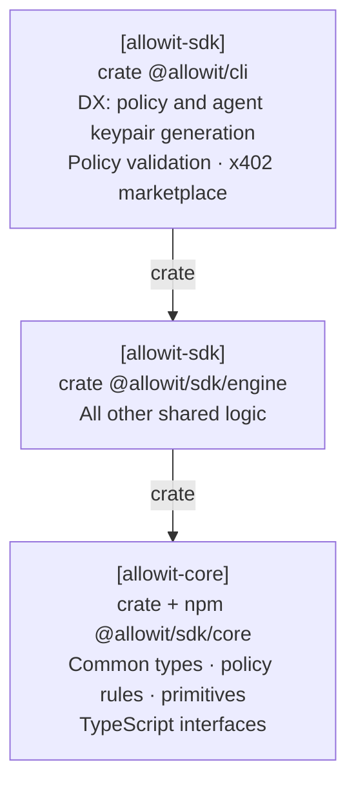

# Portable policy template

Replace [`src/policy.rs`](src/policy.rs) with your policy. [`src/lib.rs`](src/lib.rs) includes that file unchanged.
The crate uses the portable `allowit` package's host `std` feature. Soroban contracts compile the same authored source with its Soroban backend.

## Architecture

Policy authoring uses the CLI and shared SDK logic. Core owns the common policy types, rules and primitives.



Solid arrows are dependencies. Dashed arrows are runtime calls / connections.
This view follows the [canonical responsibility diagram][responsibility-model].
Use the [Cargo manifest](Cargo.toml) for Rust build package names.

```sh
cargo test --locked -p allowit-policy-template
allowit policy check cli/templates/policy/src/policy.rs
allowit policy build cli/templates/policy/src/policy.rs -o wallet.rs
```

The template first checks the owner-approved operation set, then the daily and per-payment limits.
It denies an unlisted operation or an absent or invalid required value.
The [authoring contract](../../../docs/policy-reference.md#authoring-order) defines this rule order.
Amounts use native base units. The executing host and rail supply authenticated request facts and accounting.

```rust
use allowit::prelude::*;

pub fn execute(ctx: &AllowitContext) -> allowit::Result {
    allowit::operations(ctx, &ctx.params[allowit::OPERATIONS])?;
    allowit::daily_spending_limit(ctx, &ctx.params[allowit::DAILY_SPENDING_LIMIT])?;
    allowit::payment_limit(ctx, &ctx.params[allowit::PAYMENT_LIMIT])?;
    Ok(())
}
```

Cargo type-checks this file. The shared source gate validates its portable structure.
An installation binds the exact source and owner configuration. A policy wallet also binds its installed contract code through owner-approved deployment.

[responsibility-model]: https://github.com/allowit-hq/allowit-project/blob/main/wiki/allowit/architecture.md#dependency-direction
