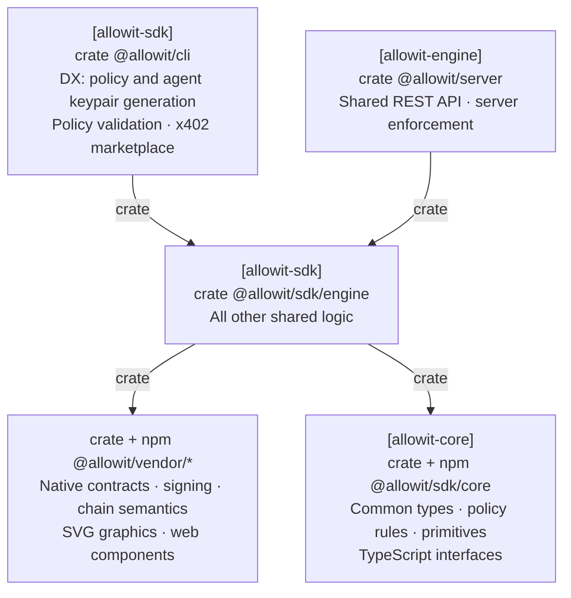

# Allowit SDK engine

`allowit-sdk-engine` is the shared offchain engine for the CLI, server engine and SDK callers.
It composes reusable rail communication and execution workflows without terminal I/O.
Callers supply arguments, configuration and the required RPC, signing, storage and authorization capabilities.

[Allowit core](https://github.com/allowit-hq/allowit-core) provides deterministic policy logic and
feature-gated host primitives. Rail cores provide native protocol and settlement semantics.

## Architecture

SDK engine composes shared logic from core primitives and vendor capabilities.
CLI and server callers use the same library and retain their own keys and authority.



[Architecture](../README.md#architecture).

## Responsibilities

| Component | Responsibility |
| --- | --- |
| SDK engine | Shared preparation, execution, status and recovery workflows for CLI and server callers |
| Allowit core | Portable policy types and validation, deterministic rules, host-only transport and journal primitives |
| Rail core | Native request encoding, addresses, signatures, simulation and settlement validation |
| Server engine | Authentication, trusted policy context, server authority, enforcement and durable application state |
| CLI | Developer workflows, policy and agent keypair generation, client validation and x402 marketplace interaction |
| Vendor adapter | Provider request/response protocols and typed facts, using common transport and workflow capabilities |

Placement follows responsibility. Generic orchestration belongs in SDK engine. Stellar execution, owner workflows, runtime clients, request validation, profiles, formatting, diagnostics and signing belong in `allowit-stellar-wallet` at `allowit-contracts-stellar/stellar/core`.
Rail packages can use common core primitives directly. Core has no dependency on SDK engine or a rail package.

## Modules

| Module | Purpose |
| --- | --- |
| `authoring` | Shared portable source gate and bounded real compilation using embedded Core resources |
| `generation` | Registered owner-authenticated generation with exact selected-rail binding |
| `owner` | Common owner deployment, funding, activation, export and receipt workflows |
| `profiles` | Verified public exports, portable imports, immutable versions and explicit selection |
| `execution`, `input` | Shared request orchestration, amount parsing and selected native format checks |
| `runtime` | Common local execution, caller-owned OperationStore and original-packet recovery |
| `vendors::stellar` | Registration and reexports of the Stellar crate provider API |
| `vendors::stellar::runtime::owner_client` | Owner sign-in and server-backed portable generation with explicit template or installation selection |
| `vendors::stellar::runtime::client` | Authenticated server requests, signer capabilities and exact-intent client resumption |
| `request`, `typed_request` | Bounded request identifiers, input documents and operation identities |
| `config`, `routing`, `wallet` | Configuration, registered network selection and caller-owned opaque signers |
| `output` | Shared printable values |
| `error` | The error type from `allowit_sdk::client::error` |

## Communication and authority

Common host transport owns HTTP and JSON-RPC bounds, deadlines and connection behavior.
SDK engine composes those primitives with rail capabilities and caller-supplied state.
Rail semantics determine whether an exact operation can be queried, resumed or resubmitted.
An uncertain mutation retains its original identity and signed bytes.
Provider delivery and chain settlement remain separate results.

`Runtime::finalize_authorization` requires the caller's authorization and retention callbacks.
The complete authorization must be durable before the second native simulation starts.
Retention failure prevents that RPC step. The caller retains the returned final packet before exposing it to an agent.

`wallet::local_signer` selects the compiled key provider without exposing native private-key bytes.
Native key formats, cryptography and message domains live in the vendor library.
SDK engine retains secure files, configuration, sessions and workflow sequencing.
`generation::generate` requires a matching signer network before selecting its registered backend capability.

`vendors::stellar::runtime::owner_client` takes a distinct caller-owned owner signer. Native helpers check the exact
sign-in message, account, Origin and nonce. The Stellar client uses Core session helpers to check freshness and require a rotated owner session.
It checks advertised generation profiles, networks and terms before sending one creation request.
The Stellar client checks returned source, params and native bindings as a draft. This draft grants no publication or spending authority.
An uncertain generation is not repeated automatically.

`vendors::stellar::runtime::client` takes a caller-owned signer capability and private core `Store`.
It saves the original intent before preparation and the exact signed proof before transmission.
It preserves packet bytes, hashes and request IDs through status and recovery.
CLI exit codes and terminal rendering stay in the CLI.

The server supplies policy admission, spending limits, trusted context and server-authority bindings.
Its durable journal binds approved requests and settlement evidence to application accounting.
The CLI supplies local signing custody and private journal storage.
SDK engine shares workflow logic between those callers without transferring their keys or authority.

Vendor adapters translate provider protocols. Generic transport, retry budgets and journal mechanics belong in common code.
An adapter exposes an explicit provider recovery contract instead of duplicating the provider's delivery workflow.

## Develop

Run these commands from the repository root:

```sh
cargo test --locked -p allowit-sdk-engine
cargo clippy --locked -p allowit-sdk-engine --all-targets -- -D warnings
```

## Compiled capabilities and public profiles

The vendor library defines network identities, protocol and presentation aliases, display labels, asset defaults and explorer links. The SDK registers those values for common routing and presentation.
A build without vendor features exposes an empty rail inventory.
CLI examples use the selected rail, then the first network supported by the build.

Owner export installs only the exact independently checked activation result.
Explicit public import checks current native authority before saving a profile.
Native imports also check the existing administrator signatures over the exact source and parameters.
Common profile parameters use Core `PolicyValue`. The selected vendor checks native addresses and converts values for its execution model.

The SDK stores public profiles separately from signing keys and private execution journals.
Each profile version retains its complete public binding and server origin.
Historical status consumes a sealed original journal context and a current request signer.
It uses the original signed configuration and packet, without a current profile or authority pin.
That status path cannot prepare or sign a replacement operation.

## Public server authority

`config::ServerAuthority::new(network, origin, public_key)` binds an independently configured public identity to a canonical rail and backend origin.
`profiles::Cache::import` takes that authority and an independent RPC endpoint.
`owner::Context` carries the same authority. The selected vendor checks the exact native role and current administrator quorum.
The common CLI records the pin with `rail trust ORIGIN PUBLIC_KEY` in the selected rail’s `server_authorities` map.

A public descriptor and an unauthenticated server response cannot supply their own trusted identity.
Fresh Native signing verifies actual source consent and current roles through independent RPC.
The compiler receives an explicit allowlist of public toolchain paths. Provider credentials, signer values and authoring overrides do not enter Python or rustc.

A resolved execution profile and its authority remain owned by one command across its journal check and dispatch.
The receipt-only recovery capability instead reads the original private record, without importing an obsolete public profile.
It accepts no fresh preparation or operation-signing path. Recovery queries the configured settlement service for the original packet.
A final success requires a verified receipt.

## Coordinated producer releases

The host crate in Core exposes provider contracts behind its optional `vendor` feature.
The SDK retains generic orchestration, storage, routing and consumer integration tests.
Its existing Stellar client paths reexport the implementation from the Stellar crate.
SDK packet deserialization delegates to that crate before exposing retained state.

Release the reviewed Core API first, then the Stellar crate on that same Core release, then the SDK.
The SDK dependency graph must use one Core release tag. Update downstream release tags and the lockfile
after those approved producer releases. Keep local validation overrides outside committed manifests.
