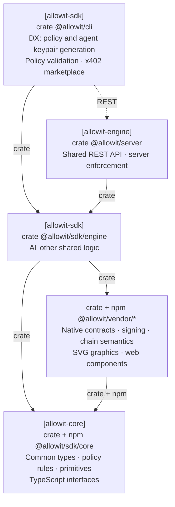

# Allowit SDK engine

`allowit-sdk-engine` is the shared offchain engine for the CLI, server engine and SDK callers.
It composes reusable rail communication and execution workflows without terminal I/O.
Callers supply arguments, configuration and the required RPC, signing, storage and authorization capabilities.

[Allowit core](https://github.com/allowit-hq/allowit-core) provides deterministic policy logic and
feature-gated host primitives. Rail cores provide native protocol and settlement semantics.

## Architecture

SDK engine composes shared logic from core primitives and vendor capabilities.
CLI and server callers use the same library and retain their own keys and authority.



Solid arrows are dependencies. Dashed arrows are runtime calls / connections.
This view follows the [canonical responsibility diagram][responsibility-model].
Use the [Cargo manifest](Cargo.toml) for Rust build package names.

## Responsibilities

| Component | Responsibility |
| --- | --- |
| SDK engine | Shared preparation, execution, status and recovery workflows for CLI and server callers |
| Allowit core | Portable policy types and validation, deterministic rules, host-only transport and journal primitives |
| Rail core | Native request encoding, addresses, signatures, simulation and settlement validation |
| Server engine | Authentication, trusted policy context, server authority, enforcement and durable application state |
| CLI | Developer workflows, policy and agent keypair generation, client validation and x402 marketplace interaction |
| Vendor adapter | Provider request/response protocols and typed facts, using common transport and workflow capabilities |

Placement follows responsibility. A reusable rail workflow belongs in SDK engine even when its first caller is the server.
Rail packages can use common core primitives directly. Core has no dependency on SDK engine or a rail package.

## Modules

| Module | Purpose |
| --- | --- |
| `authoring` | Shared portable source gate and bounded real compilation using embedded Core resources |
| `stellar` | Native execution, caller-owned OperationStore, ordered authorization retention and exact-hash recovery |
| `stellar::owner_client` | Owner sign-in and server-backed portable generation with explicit template or installation selection |
| `stellar::client` | Authenticated server requests, signer capabilities and exact-intent client resumption |
| `request`, `typed_request` | Bounded request identifiers, input documents and operation identities |
| `config`, `routing`, `wallet` | Configuration, Stellar network selection and caller-owned key bindings |
| `output` | Shared printable values |
| `error` | The error type from `allowit_sdk::client::error` |

## Communication and authority

Common host transport owns HTTP and JSON-RPC bounds, deadlines and connection behavior.
SDK engine composes those primitives with rail capabilities and caller-supplied state.
Rail semantics determine whether an exact operation can be queried, resumed or resubmitted.
An uncertain mutation retains its original identity and signed bytes.
Provider delivery and chain settlement remain separate results.

`Runtime::finalize_authorization` requires the caller's authorization and retention callbacks.
The complete authorization must be durable before the second native simulation starts.
Retention failure prevents that RPC step. The caller retains the returned final packet before exposing it to an agent.

`stellar::owner_client` takes a distinct caller-owned owner signer. It checks the complete sign-in
message, account, Origin, nonce and expiry before signing, then requires a rotated owner session.
It validates advertised generation profiles, networks and terms before sending one creation request.
Returned source, params and native bindings are checked as a draft, never as publication or spending authority.
An uncertain generation is not repeated automatically.

`stellar::client` takes a caller-owned signer capability and private core `Store`.
It saves the original intent before preparation and the exact signed proof before transmission.
It preserves packet bytes, hashes and request IDs through status and recovery.
CLI exit codes and terminal rendering stay in the CLI.

The server supplies policy admission, spending limits, trusted context and server-authority bindings.
Its durable journal binds approved requests and settlement evidence to application accounting.
The CLI supplies local signing custody and private journal storage.
SDK engine shares workflow logic between those callers without transferring their keys or authority.

Vendor adapters translate provider protocols. Generic transport, retry budgets and journal mechanics belong in common code.
An adapter exposes an explicit provider recovery contract instead of duplicating the provider's delivery workflow.

## Develop

Run these commands from the repository root:

```sh
cargo test --locked -p allowit-sdk-engine
cargo clippy --locked -p allowit-sdk-engine --all-targets -- -D warnings
```

[responsibility-model]: https://github.com/allowit-hq/allowit-project/blob/main/wiki/allowit/architecture.md#dependency-direction
